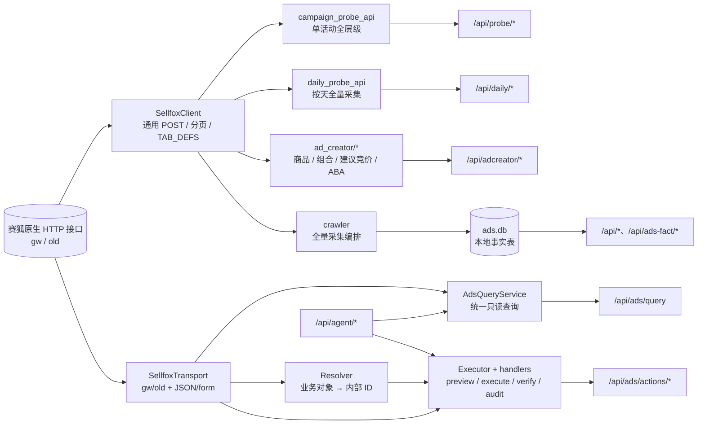

# 赛狐接口封装与调用关系

> 审计时间：2026-11-14  
> 原生接口文档：`docs/wiki/02-接口总表.md`、`docs/wiki/06-写-活动与组.md`、`docs/wiki/08-写-产品与否定.md`  
> 代码范围：`backend/**/*.py`

---

## 0. 统计口径

| 项目 | 数量 |
|---|---:|
| 接口总表主接口 | 50 |
| 关键词待实测写接口 | 11 |
| Python 实际引用的唯一赛狐路径 | 51 |
| 其中读 / 校验接口 | 34 |
| 其中写接口 | 17 |
| `actions.json` 写动作 | 18 |
| 已有 handler 的写动作 | 18 / 18 |

说明：

- `18 个动作 / 17 个写路径`：`create_campaign` 和 `add_group` 共用 `ad/sp/create`。
- “文档登记”不等于“已封装”。本文单独列出未封装接口。
- “通用传输封装”指只能通过 `SellfoxClient.post()` / `fetch_pages()` 发请求，没有稳定的业务函数。

状态图例：

| 标记 | 含义 |
|---|---|
| ✅ | 已有稳定业务封装或动作 handler |
| 🟡 | 只有通用传输 / 采集封装 |
| ❌ | 文档已登记，代码未封装 |
| ⚪ | 本地数据或非赛狐接口 |

---

## 1. 分层架构



---

## 2. 读接口：原生 → 封装 → 上层

### 2.1 活动

| 原生路径 | 文档 | 封装 | 上层调用 | 状态 |
|---|---|---|---|---|
| `campaign/getAllCampaignData` | 02 A / 03 | `Resolver.list_campaigns`、`AdsQueryService._all_campaign_rows`、`campaign_probe.layer_campaign_list` | `/api/ads/query`、`/api/probe/fetch`、`/api/crawl` | ✅ |
| `campaign/getAllCampaignAggregateData` | 02 A | `SellfoxClient.fetch_aggregate` | 全量采集 | 🟡 |
| `campaign/getAllCampaignHourData` | 02 A | `daily_probe.collect_campaign_hour` | `/api/daily/start` | ✅ |
| `adCampaign/getInfo` | 02 A / 03 | `Resolver.campaign_config`、`campaign_probe.layer_campaign_info` | 预算 preview、`/api/probe/fetch` | ✅ |

### 2.2 广告组、投放、广告产品、广告位

| 原生路径 | 文档 | 封装 | 上层调用 | 状态 |
|---|---|---|---|---|
| `multiple/group/getAllGroupData` | 02 A / 03 | `Resolver.list_groups`、`AdsQueryService.groups`、`campaign_probe.layer_groups`、`daily_probe.list_groups` | `/api/ads/query`、`/api/probe/*`、`/api/daily/*` | ✅ |
| `multiple/group/getAllGroupAggregateData` | 02 A | `SellfoxClient.fetch_aggregate` | 全量采集 | 🟡 |
| `multiple/group/getAllGroupHourData` | 02 A | `daily_probe.collect_one_day` | `/api/daily/start` | ✅ |
| `multiple/target/getAllTargetData` | 02 A / 03 | `Resolver.list_targets`、`AdsQueryService.targets`、`campaign_probe.layer_targets`、`daily_probe.list_targets` | `/api/ads/query`、`/api/probe/*`、`/api/daily/*` | ✅ |
| `multiple/target/getAllTargetAggregateData` | 02 A | `SellfoxClient.fetch_aggregate` | 全量采集 | 🟡 |
| `multiple/target/getAllTargetHourData` | 02 A / 03 | `campaign_probe.layer_hourly`、`daily_probe.collect_targets_hour` | `/api/probe/*`、`/api/daily/*` | ✅ |
| `multiple/adProduct/getAdProductList` | 02 A / 03 | `Resolver.list_ad_products`、`AdsQueryService.products`、`campaign_probe.layer_products`、`daily_probe.list_products` | `/api/ads/query`、`/api/probe/*`、`/api/daily/*` | ✅ |
| `multiple/adProduct/getAllProductAggregateData` | 02 A | `SellfoxClient.fetch_aggregate` | 全量采集 | 🟡 |
| `multiple/adProduct/getAllProductHourData` | 02 A | `daily_probe.collect_products` | `/api/daily/start` | ✅ |
| `multiple/placement/getAllPlacementData` | 02 A / 03 | `Resolver.list_placements`、`AdsQueryService.placements`、`campaign_probe.layer_placements` | `/api/ads/query`、`/api/probe/*` | ✅ |
| `multiple/placement/getAllPlacementAggregateData` | 02 A | `SellfoxClient.fetch_aggregate` | 全量采集 | 🟡 |
| `multiple/placement/getAllPlacementHourData` | 02 A | `daily_probe.collect_placements` | `/api/daily/start` | ✅ |

### 2.3 组合

| 原生路径 | 文档 | 封装 | 上层调用 | 状态 |
|---|---|---|---|---|
| `multiple/portfolio/getAllPortfolioData` | 02 A | `SellfoxClient.fetch_list` / `TAB_DEFS` | `/api/portfolios`、全量采集 | 🟡 |
| `multiple/portfolio/getAllPortfolioAggregateData` | 02 A | `SellfoxClient.fetch_aggregate` | 全量采集 | 🟡 |
| `commonMultiShop/getPortfolioListProductRight` | 02 A | `SellfoxClient.get_shops` 内部 `SHOP_PORTFOLIO_API` | `/api/shops` 等 | 🟡 |
| `/api/portfolio/getAllPortfolioDataProductRight.json` | 02 A / 09 | `ad_creator.portfolios.fetch_from_sellfox` | `/api/adcreator/portfolios` | ✅ |

### 2.4 搜索词、否定项、日志

| 原生路径 | 文档 | 封装 | 上层调用 | 状态 |
|---|---|---|---|---|
| `multiple/search/getAllSearchData` | 02 B / 04 | `AdsQueryService._search`、`campaign_probe.layer_search`、`daily_probe.collect_search` | `/api/ads/query`、`/api/probe/*`、`/api/daily/*` | ✅ |
| `multiple/search/getAllSearchAggregateData` | 02 B | `SellfoxClient.fetch_aggregate` | 全量采集 | 🟡 |
| `multiple/neTarget/getAllNeTargetData` | 02 A / 08 | `Resolver.list_negatives`、`campaign_probe.layer_negatives` | 否定项 preview、`/api/probe/*` | ✅ |
| `log/sellfoxAndAuto/getPage` | 02 A / 03 | `campaign_probe.layer_logs` | `/api/probe/fetch` | ✅ |
| `/api/cpcSPManage/product/searchAsinsForTargeting.json` | 02 I / 08 | `Resolver.validate_target_asin`、`ad_creator.suggest_bid.search_asins_for_targeting` | 否定 ASIN preview、`/api/adcreator/search-asins-for-targeting` | ✅ |

### 2.5 商品、店铺、父体

| 原生路径 | 文档 | 封装 | 上层调用 | 状态 |
|---|---|---|---|---|
| `product/productRightSpPageListSearch` | 02 C / 05 | `Resolver.live_products`、`ad_creator.sellfox_products` | 创建活动 preview、`/api/adcreator/search` | ✅ |
| `/api/gw/sellfox/sellfox-product/sellfox/product/pageList` | 02 C / 05 | `online_product.fetch_all` / `fetch_page` | `/api/online/*` 同步、`/api/crawl` | ✅ |
| `/api/parent/product/pageList.json` | 02 C / 05 | `online_product` 父体接口 | 在线商品同步 | ✅ |
| `/api/excel/getHeadField.json` | 02 C / 05 | `online_product.fetch_head_fields` | 在线商品同步 | ✅ |
| `/shop/getAllShopSite.json` | 02 C / 05 | `online_product.fetch_shops` | 店铺同步 | ✅ |

### 2.6 建议竞价、关键词、ABA

| 原生路径 | 文档 | 封装 | 上层调用 | 状态 |
|---|---|---|---|---|
| `multiple/target/suggestBid/recommendations` | 02 B / 04 | `ad_creator.suggest_bid.fetch_bids` | `/api/adcreator/suggest-bids`、创建活动 | ✅ |
| `adKeyword/sp/suggestKeywordsByAsin/page` | 02 B / 04 | `ad_creator.suggest_bid.fetch_suggest_keywords` | `/api/adcreator/suggest-keywords` | ✅ |
| `/api/search/terms/analysis/getTrend.json` | 02 B / 04 | `ad_creator.suggest_bid.fetch_aba_rank_trend` | `/api/adcreator/aba-rank-trend` | ✅ |
| `spTarget/getSuggestedBid` | 02 A / 03 | `campaign_probe.layer_suggested_bid`、`daily_probe.suggested_bids` | `/api/probe/*`、`/api/daily/*` | ✅ |

---

## 3. 写接口：原生 → action → handler → 上层

所有写动作统一走：

```text
/api/ads/actions/preview
  → confirm_token
  → /api/ads/actions/execute
  → verify
  → ad_action_log
```

Agent 计划执行走：

```text
/api/agent/runs/{id}/approve
  → /api/agent/runs/{id}/preview
  → /api/agent/runs/{id}/execute (confirm=true)
  → 复用同一 Executor
```

| 原生路径 | 编码 | action | handler | 上层 |
|---|---|---|---|---|
| `ad/sp/create` | JSON | `create_campaign`、`add_group` | `CreateCampaignHandler`、`AddGroupHandler` | `/api/ads/actions/*`、`/api/agent/*` |
| `spCampaign/update` | JSON | `set_campaign_budget` | `SetCampaignBudgetHandler` | 同上 |
| `spCampaign/updateState` | form | `set_campaign_state` | `SetCampaignStateHandler` | 同上 |
| `spCampaign/archive` | form | `archive_campaign` | `ArchiveCampaignHandler` | 同上 |
| `/api/cpcSPManage/campaign/updateName.json` | form | `rename_campaign` | `RenameCampaignHandler`、`rename_tool.py` | 同上 / CLI |
| `/api/cpcSPManage/group/update.json` | JSON | `set_group_bid` | `SetGroupBidHandler`、`rename_tool.py` | 同上 / CLI |
| `/api/cpcSPManage/group/updateState.json` | form | `set_group_state` | `SetGroupStateHandler` | 同上 |
| `spTarget/updateBid` | form | `set_target_bid` | `SetTargetBidHandler` | 同上 |
| `spTarget/updateState` | form | `set_target_state` | `SetTargetStateHandler` | 同上 |
| `/api/cpcSPManage/campaign/updatePlacementAdjustment.json` | form | `set_campaign_placement` | `SetCampaignPlacementHandler` | 同上 |
| `/api/cpcSPManage/product/v2/add.json` | JSON | `add_products_to_group` | `AddProductsToGroupHandler` | 同上 |
| `/api/cpcSPManage/product/updateState.json` | form | `set_ad_product_state` | `SetAdProductStateHandler` | 同上 |
| `/api/cpcSPManage/product/archive.json` | form | `archive_ad_product` | `ArchiveAdProductHandler` | 同上 |
| `negative/createSpGroupNeKeywords` | JSON | `add_negative_keyword` | `AddNegativeKeywordHandler` | 同上 |
| `spTarget/createNeTargeting` | JSON | `add_negative_asin` | `AddNegativeAsinHandler` | 同上 |
| `multiple/neTarget/updateBatchMultiShop` | JSON | `archive_negative` | `ArchiveNegativeHandler` | 同上 |
| `/api/portfolio/movePortFolioData.json` | form | `move_campaign_portfolio` | `MoveCampaignPortfolioHandler` | 同上 |

### 动作清单

| 等级 | 动作 |
|---|---|
| L1 | `set_target_bid`、`set_target_state`、`set_group_bid`、`set_group_state`、`set_campaign_state`、`set_campaign_placement`、`set_campaign_budget`、`set_ad_product_state` |
| L2 | `add_negative_keyword`、`add_negative_asin`、`archive_negative`、`add_products_to_group`、`archive_ad_product`、`add_group`、`rename_campaign`、`move_campaign_portfolio` |
| L3 | `create_campaign`、`archive_campaign` |

---

## 4. 文档已登记、代码未封装

| 原生路径 | 说明 |
|---|---|
| `target/bid/batchAsyncUpdateBid` | 批量调价 |
| `target/task/list` | 批量任务进度 |
| `/api/cpc/group/getInfo.json` | 单组详情 |
| `spCampaign/updatePlacementAdjustment` | gw 灰度广告位，代码用 old 路径 |
| `multiple/placement/batchUpdatePlacementAdjustment` | 批量广告位，契约未打通 |
| `/api/portfolio/createPortfolioData.json` | 创建组合 |
| `/api/portfolio/updatePortFolioData.json` | 修改组合 |
| `/api/portfolio/updatePortfolioHiddenState.json` | 隐藏组合 |
| `/api/portfolio/removePortFolioData.json` | 删除组合，文档标记死代码 |
| `strategy/insertTemplate` | 建分时预算模板 |
| `strategy/schedule/submitStrategy` | 应用策略模板 |
| `strategy/getPageTemplate` | 读模板 |
| `strategy/deleteTemplate` | 删模板 |
| `spKeyword/getSuggestedBid` | 关键词建议竞价，当前用 target 推荐接口替代 |
| `spKeyword/getSuggestedBidByText` | 按词建议竞价，未封装 |
| `spKeyword/createKeywords` | 关键词写接口，未实测 |
| `spKeyword/asyncCreateKeywords` | 同上 |
| `spKeyword/updateBid` | 同上 |
| `spKeyword/updateState` | 同上 |
| `spKeyword/updateBatch` | 同上 |
| `spKeyword/updateBatchMultiShop` | 同上 |
| `spKeyword/archive` | 同上 |
| `spKeyword/suggestKeywords` | 同上 |
| `spKeyword/suggestKeywordsByAsin` | 当前使用 `adKeyword/sp/suggestKeywordsByAsin/page` |

> 关键词接口整体仍属于未稳定区，不建议 Agent 直接依赖。

---

## 5. 上层 API 汇总

### 读 / 查询

| API | 实现 | 作用 |
|---|---|---|
| `POST /api/ads/query` | `AdsQueryService` | 统一查询活动/组/投放/产品/广告位/搜索词/搜索 ASIN/数据覆盖 |
| `GET /api/ads/tools` | `tool_manifest` | 给大模型的工具清单和 selector schema |
| `GET /api/ads/tools/actions` | `tool_manifest` | 动作目录 |
| `GET /api/probe/*` | `campaign_probe_api` | 单活动全层级取数 |
| `GET/POST /api/daily/*` | `daily_probe_api` | 按天全量采集、落库、查询 |
| `GET/POST /api/adcreator/*` | `ad_creator_api` | 商品、组合、建议竞价、ABA、关键词 |
| `POST /api/crawl` | `crawler` | 全量采集到本地 |
| `GET /api/ads-fact/*` | `ads_fact_api` | 本地广告产品级分时查询 |
| `GET /api/*` | `backend/api.py` | 本地数据、竞品、在线商品、翻译等 |

### 写 / Agent

| API | 实现 | 作用 |
|---|---|---|
| `GET /api/ads/actions` | `registry` | 18 个动作目录 |
| `POST /api/ads/actions/preview` | `Executor.preview` | 解析对象、生成 before/after/token |
| `POST /api/ads/actions/execute` | `Executor.execute` | 执行并读回 |
| `GET /api/ads/actions/logs/{request_id}` | `audit` | 审计 |
| `POST /api/agent/runs` | `AgentOrchestrator` | 分析、诊断、策略计划 |
| `POST /api/agent/runs/{id}/approve` | `AgentOrchestrator` | 审批 |
| `POST /api/agent/runs/{id}/preview` | `AgentOrchestrator` | 对计划动作生成 preview |
| `POST /api/agent/runs/{id}/execute` | `AgentOrchestrator` | `confirm=true` 后执行计划 |

---

## 6. 关键调用链

### 读数据

```text
大模型 / 前端
  → /api/ads/query
  → AdsQueryService
  → SellfoxTransport
  → campaign / group / target / product / placement / search
```

### 写动作

```text
大模型 / 前端
  → /api/ads/actions/preview
  → Executor.preview
  → Resolver 解析业务对象
  → handler.prepare 生成请求
  → confirm_token
  → /api/ads/actions/execute
  → handler.execute
  → SellfoxTransport
  → handler.verify
  → ad_action_log
```

### Agent

```text
POST /api/agent/runs
  → AgentOrchestrator
  → AdsQueryService（活动 + 搜索词 + 组）
  → 诊断 + 规则策略
  → awaiting_approval
  → approve
  → preview_plan
  → Executor.preview
  → execute_plan（confirm=true）
  → Executor.execute
  → audit
```

### 全量采集

```text
POST /api/crawl
  → crawler.run_crawl
  → SellfoxClient.fetch_list / fetch_aggregate
  → ads_store
  → ads.db
  → /api/*、/api/ads-fact/*
```

---

## 7. 结论

1. **读接口覆盖较完整**：活动、组、投放、产品、广告位、搜索词、否定、日志、商品、组合、建议竞价均有固定代码。
2. **写接口已完整覆盖 18 个动作**，但其中 17 个写路径，创建和加组共用 `ad/sp/create`。
3. **文档登记但未封装的主要是**：组合增删改、策略模板、批量调价、批量广告位、关键词写接口。
4. **大模型可稳定使用的最小工具集**：
   - `ads_action_catalog`
   - `ads_query`
   - `ads_preview`
   - `ads_execute`
5. **不应对大模型暴露**：
   - 任意赛狐 URL
   - Cookie
   - 内部 target id / group id
   - 批量关键词写接口（尚未稳定）
